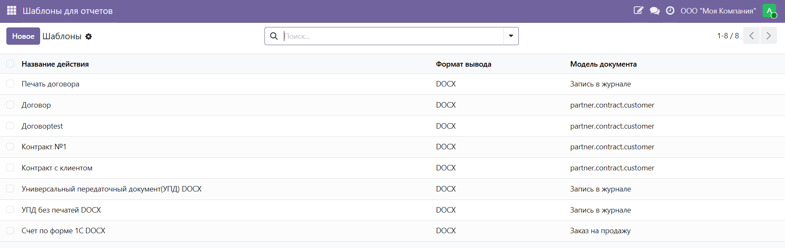
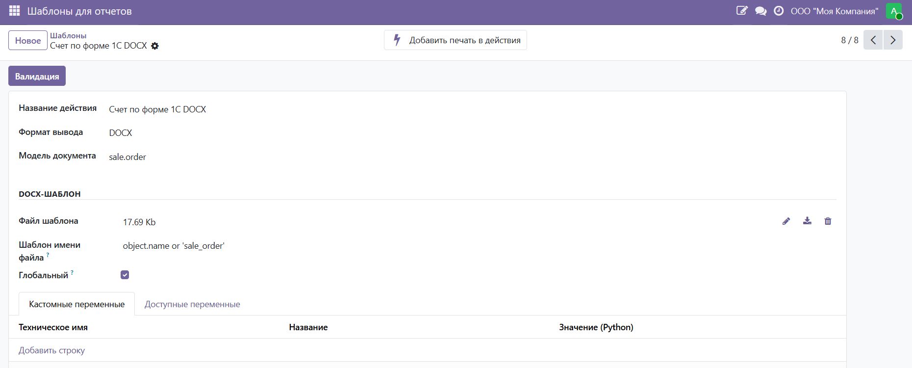
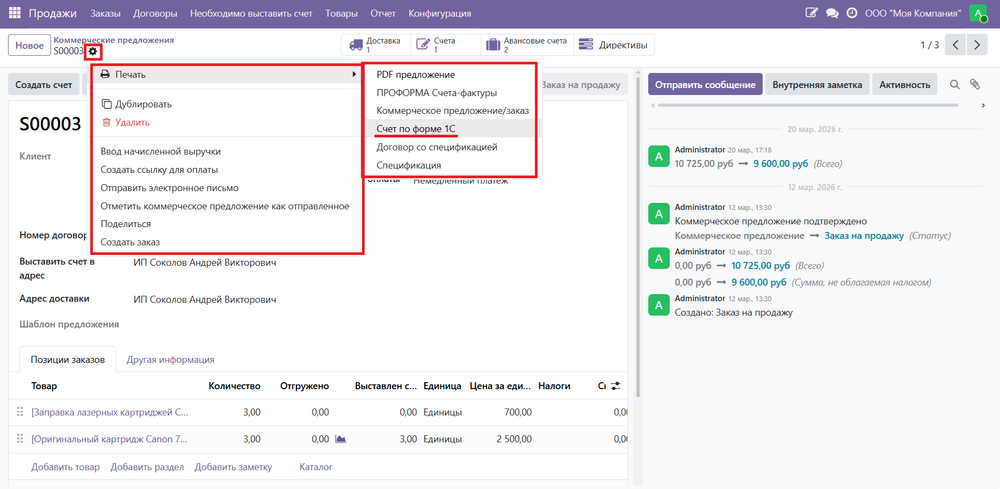
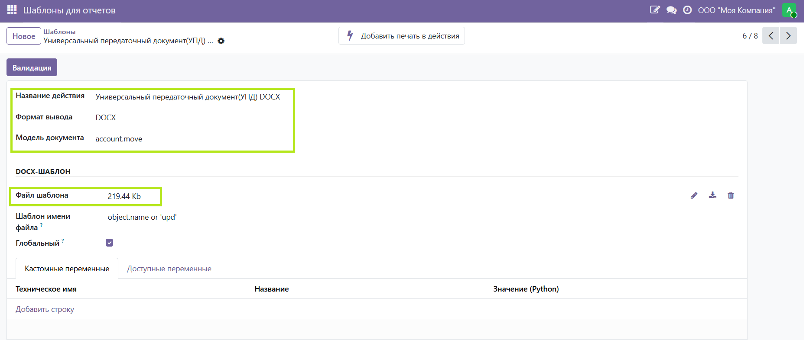
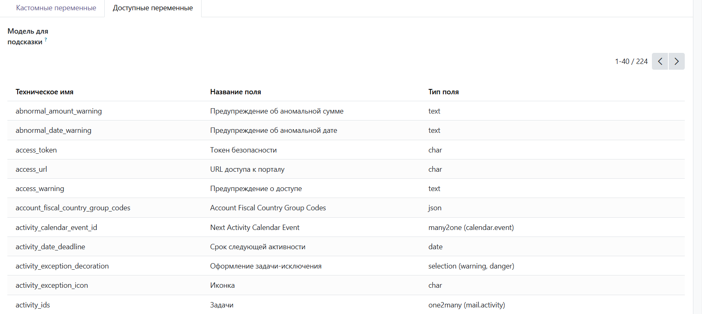
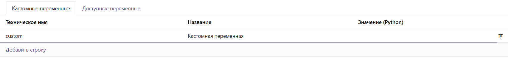
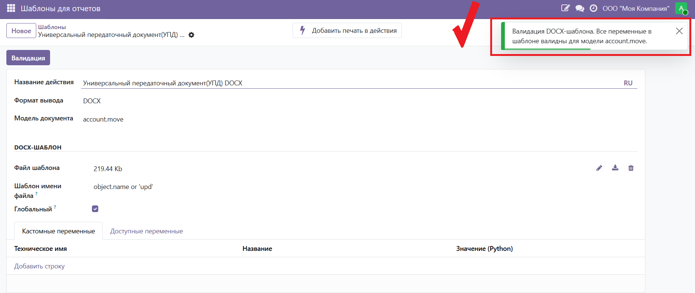
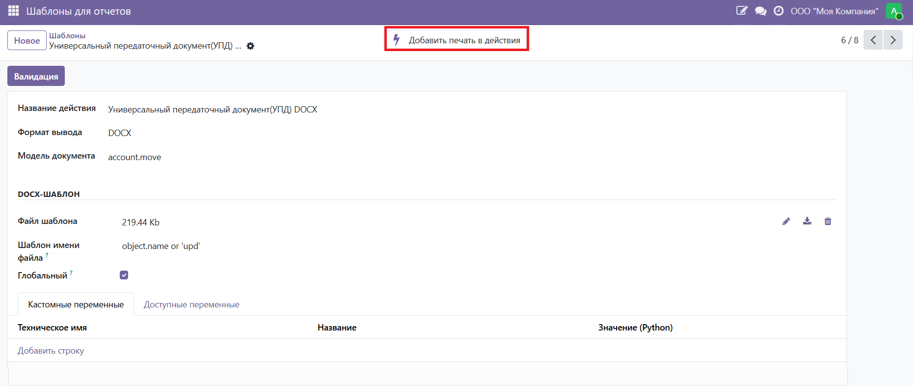
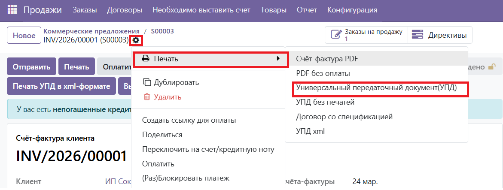

# DOCX-шаблоны
name: docx_report
version: 19.0.1.0.0
author: Mk.Lab

### 1. Общее описание

Модуль добавляет в Odoo систему DOCX-шаблонов для печати документов. Вместо стандартных HTML-отчётов пользователь загружает файл `.docx` с разметкой переменных — и система формирует готовый документ Word, подставляя данные из карточки записи.

Модуль расширяет возможности базового `docx_report_generation`: добавляет интерфейс управления шаблонами, валидацию, кастомные переменные и привязку шаблонов к моделям.

### 2. Установка

1. Убедитесь что установлены модули `docx_report_generation`, `account`, `sale`, `l10n_ru_contract`

2. Установите Python-пакеты: `pip install docxtpl docxcompose beautifulsoup4`

3. Скопируйте папку `docx_report` в директорию `addons`

4. Перезапустите сервер Odoo

5. Обновите список приложений: **Настройки → Приложения → Обновить список**

6. Найдите модуль **«DOCX Templates»** и установите

### 3. Функциональность

3.1 Основные возможности:

- Загрузка `.docx`-файла как шаблона отчёта для любой модели Odoo
- Подстановка данных из записи через переменные `{{ object.field }}`
- Условные конструкции `` и циклы `` в шаблоне
- Кастомные переменные с произвольными Python-выражениями
- Валидация шаблона: проверка синтаксиса и существования полей модели
- Подсказки доступных полей выбранной модели прямо в форме шаблона
- Привязка шаблона к форме записи через меню печати

3.2 Синтаксис шаблона:

| Конструкция | Пример | Описание |
|---|---|---|
| Переменная | `{{ object.name }}` | Значение поля записи |
| Связанное поле | `{{ object.partner_id.name }}` | Поле через Many2one |
| Условие | `...` | Условный вывод |
| Цикл | `...` | Перебор строк |
| Кастомная переменная | `{{ my_var }}` | Переменная из вкладки «Кастомные переменные» |
| Дата | `{{ time.strftime('%d.%m.%Y') }}` | Текущая дата |

3.3 Меню:

В главном меню появляется пункт **«Шаблоны для отчетов»** — список всех DOCX-шаблонов.

## Как это выглядит в интерфейсе

Форма шаблона содержит основные поля, кнопку **«Валидация»** и две вкладки: **«Кастомные переменные»** и **«Доступные переменные»**.

После привязки шаблона к модели в меню **⚙️ Печать** записи появляется дополнительный пункт с именем шаблона.

### Пример использования

### Создать шаблон

Перейдите в меню **«Шаблоны для отчетов»**, нажмите **Создать**. Укажите название, загрузите `.docx`-файл, выберите модель документа.

### Проверить доступные поля

На вкладке **«Доступные переменные»** выберите модель для подсказки — отобразится список всех полей с техническими именами и типами. Используйте их при создании шаблона.

### Добавить кастомную переменную (если нужно)

На вкладке **«Кастомные переменные»** добавьте переменную: укажите техническое имя и Python-выражение для вычисления значения.

### Проверить шаблон

Нажмите кнопку **«Валидация»** в шапке формы. Система проверит синтаксис и существование всех полей в шаблоне, отобразит результат.

### Привязать шаблон к модели

Нажмите кнопку **«Добавить печать в действия»** — шаблон появится в меню ⚙️ Печать для записей выбранной модели.

### Распечатать документ

Откройте нужную запись (договор, заказ и т.д.) → меню **⚙️ Печать** → выберите название шаблона. Файл `.docx` скачается автоматически.

